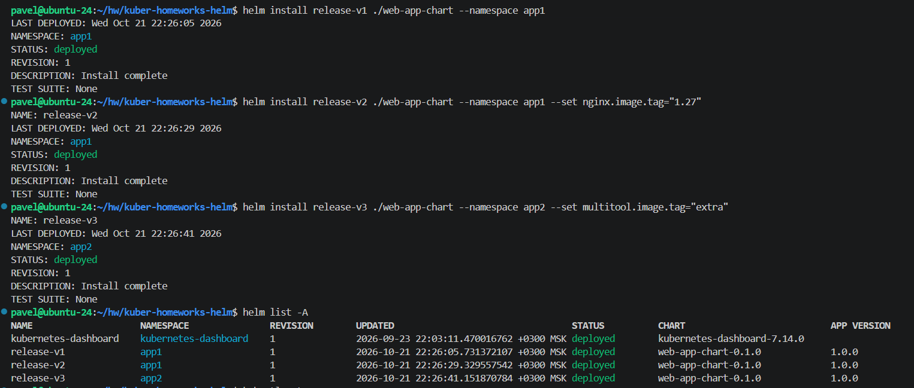
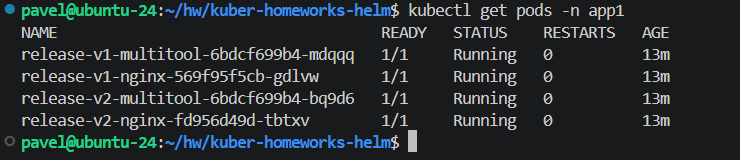
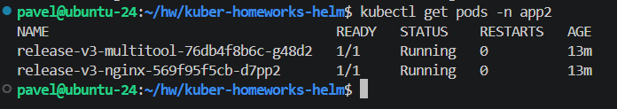
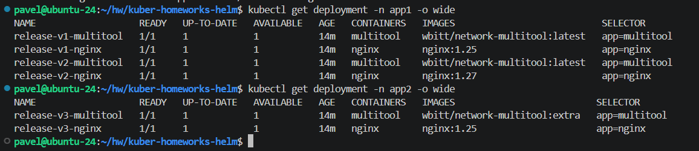

# Домашнее задание к занятию «`Helm`» - `Рыбянцев Павел`

------

Репозиторий содержит созданный Helm-чарт, манифесты конфигурации и отчёт о развёртывании нескольких версий приложения в изолированных пространствах имён (`namespaces`). Локальный кластер развернут с помощью MicroK8s.

---

##  Задание 1. Подготовить Helm-чарт для приложения

### Исходные файлы чарта:
* Метаданные: [web-app-chart/Chart.yaml](web-app-chart/Chart.yaml)
* Переменные окружения: [web-app-chart/values.yaml](web-app-chart/values.yaml)
* Шаблон Nginx: [web-app-chart/templates/deployment-nginx.yaml](web-app-chart/templates/deployment-nginx.yaml)
* Шаблон Multitool: [web-app-chart/templates/deployment-multitool.yaml](web-app-chart/templates/deployment-multitool.yaml)

### Описание решения:
1. Создан кастомный Helm-чарт `web-app-chart` для шаблонизации развёртывания приложения.
2. Согласно ТЗ, компоненты приложения разделены: `nginx` и `multitool` деплоятся независимыми объектами `Deployment`.
3. Версии и теги образов контейнеров полностью вынесены в файл параметров `values.yaml` для обеспечения гибкой настройки манифестов под разные окружения без ручной правки шаблонов. Конфликт портов устранён через подстановку переменной `HTTP_PORT: "8080"` для multitool.

---

## Задание 2. Запустить две версии в разных неймспейсах

### Команды подготовки и развёртывания релизов:
```bash
# 1. Создание изолированных пространств имён
kubectl create namespace app1
kubectl create namespace app2

# 2. Деплой первой копии (release-v1) в app1 с дефолтными версиями из values.yaml
helm install release-v1 ./web-app-chart --namespace app1

# 3. Деплой второй копии (release-v2) в app1 с переопределением тега Nginx на версию 1.27
helm install release-v2 ./web-app-chart --namespace app1 --set nginx.image.tag="1.27"

# 4. Деплой третьей копии (release-v3) в app2 с переопределением тега multitool
helm install release-v3 ./web-app-chart --namespace app2 --set multitool.image.tag="extra"
```

### Проверка работоспособности и демонстрация результатов:

**1. Вывод списка всех запущенных Helm-релизов в кластере:**
```bash
helm list -A
```


**2. Состояние подов в пространстве имён app1:**
```bash
kubectl get pods -n app1
```


**3. Состояние подов в пространстве имён app2:**
```bash
kubectl get pods -n app2
```


**4. Подтверждение изменения версий (тегов) образов в деплойментах:**
```bash
kubectl get deployment -n app1 -o wide
kubectl get deployment -n app2 -o wide
```
